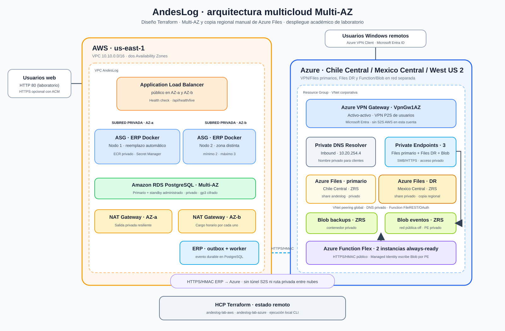

# AndesLog — Terraform multicloud

Este repositorio define la infraestructura de AndesLog en AWS y Azure. AWS aloja el ERP y PostgreSQL; Azure ofrece VPN de usuarios, Azure Files privado y la Function/Blob que reciben eventos de negocio desde el ERP. `scripts/lab.ps1` orquesta los dos workspaces HCP Terraform y el bootstrap de la aplicación.

**Pruebas del 2026-11-10:** el comando de despliegue completó los planes sin diferencias y el ERP registró un movimiento cuyo evento llegó a Azure por HTTPS/HMAC. La copia secundaria de Azure Files se probó con ocho archivos y el ASG reemplazó un nodo durante una falla controlada. AWS Academy bloquea Site-to-Site, por lo que este laboratorio no dispone de una ruta privada intercloud. Consulta el estado actual con `lab.ps1 -Action Status` y en los portales: los resultados son históricos una vez que se da de baja el laboratorio. El comando de baja conserva el share primario `andeslog`, su cuenta y grupo de recursos, que pueden seguir generando cargos.

## Arquitectura definida



[Detalles de componentes](docs/ARQUITECTURA_TERRAFORM.md) · [Diseño y pruebas de resiliencia](docs/RESILIENCIA.md) · [Presupuesto de referencia de producción](docs/PRESUPUESTO_PRODUCCION.md) · [Diagrama histórico de octubre](docs/ARQUITECTURA_DESPLEGADA.md)

Para la asesoría, usa la [guía rápida de despliegue, demostración y baja](docs/GUIA_DEMOSTRACION.md).

| Componente | Diseño y estado del último despliegue |
| --- | --- |
| ERP | ALB en dos AZ → ASG privado con mínimo 2 nodos, reemplazo por health check y escalado CPU hasta 3. Imagen privada e inmutable en ECR. |
| Base | PostgreSQL RDS Multi-AZ privado, cifrado, backups automáticos y contraseña maestra administrada por RDS. |
| ERP→Azure | Outbox transaccional en PostgreSQL → dos workers del ASG → Function HTTPS/HMAC → Blob ZRS mediante identidad administrada y Private Endpoint. Probado en nube. |
| Intercloud | El código soporta Azure `VpnGw1AZ` activo-activo, AWS Virtual Private Gateway y cuatro túneles BGP/IPsec. No se desplegaron en AWS Academy porque la política deniega `ec2:CreateCustomerGateway`. |
| VPN de usuarios | Azure VPN Client para Windows, OpenVPN P2S y autenticación Microsoft Entra, sobre un gateway `VpnGw1AZ` activo-activo. |
| Archivos | Share primario Azure Files en Chile Central y copia SMB independiente en Mexico Central; ambas cuentas ZRS, acceso público deshabilitado y Private Endpoints. Una Function Timer programa la copia por rutas privadas, OAuth con propósito `backup` e identidad administrada dedicada; la réplica es unidireccional y conserva elementos exclusivos del destino. Se probaron ocho archivos en Azure, sin demostrar recuperación regional ni RPO. |
| Egreso privado | NAT Gateway por AZ para que el ASG pueda descargar imágenes y reemplazar nodos. Tiene costo horario mientras está activo. |
| Storage y serverless | Blob de eventos privado ZRS y Function de integración; auditoría de backups/Event Grid opcional. Se eliminan con la baja del laboratorio. |
| Operación | Dashboard y alarmas CloudWatch y Azure Monitor; se eliminan con la baja y una nueva suscripción SNS requiere confirmación por correo. |

El ALB usa HTTP de laboratorio salvo que se configure un certificado ACM validado para un dominio propio. No envíes credenciales por HTTP ni presentes este MVP como listo para producción. Multi-AZ cubre fallas de instancia/zona. El código local programa la copia Azure Files cada minuto y una alerta de cinco minutos sin éxitos, evaluada cada minuto; la latencia de logs puede generar avisos tardíos o falsos. La antigüedad de un marcador es una señal operativa, no una prueba del RPO ni de consistencia. La promoción regional de Files sigue siendo manual. La recuperación regional de la aplicación y PostgreSQL todavía no está implementada.

## Requisitos en Windows

Instala Terraform CLI **1.11 o posterior**, AWS CLI v2, Azure CLI, Docker Desktop y OpenSSH. Inicia Docker Desktop antes del despliegue. Verifica:

```powershell
terraform version
aws --version
az version
docker info
ssh -V
```

Clona el ERP como proyecto hermano de este repositorio, por ejemplo `AndesLogProject\AndesLog-Terraform` y `AndesLogProject\ERP-APP`. Se necesita la cuenta HCP Terraform con permiso para usar los workspaces `andeslog-lab-aws` y `andeslog-lab-azure`.

## Sesiones y credenciales temporales

No guardes credenciales cloud en Git, `terraform.tfvars`, overlays o scripts. Las sesiones caducan; actualízalas desde sus portales oficiales antes de cada ventana de trabajo.

### HCP Terraform

```powershell
$env:TF_CLOUD_ORGANIZATION = "AndesLog"
terraform login
# Correo por entorno; debe coincidir con la suscripción SNS que quieres conservar.
$env:TF_VAR_notification_email = "tu-correo@example.com"
```

Los dos workspaces deben estar configurados con ejecución **Local** para que Terraform use las sesiones CLI locales. El estado sigue siendo remoto en HCP.
No guardes ese valor en Git. La misma variable se usa en ambos roots: si la omites, Terraform puede proponer eliminar las notificaciones de AWS (SNS) y Azure (Action Group y alertas). Confirma el mensaje de AWS SNS para que sus alertas lleguen a la bandeja de entrada.

### AWS Academy

Inicia el laboratorio en AWS Academy y configura un perfil local con las credenciales temporales entregadas por el portal (Access Key, Secret Access Key y Session Token). No necesitas crear un IAM username personal para el Learner Lab.

```powershell
aws configure --profile andeslog-academy
# Completa Access Key y Secret Access Key cuando CLI los solicite.
# Configura token temporal y región:
aws configure set aws_session_token <TOKEN_TEMPORAL> --profile andeslog-academy
aws configure set region us-east-1 --profile andeslog-academy
$env:AWS_PROFILE = "andeslog-academy"
aws sts get-caller-identity
```

`get-caller-identity` debe mostrar la cuenta AWS esperada por `lab.ps1`. Si el portal Academy entrega credenciales renovadas, actualiza el perfil; no reuses una sesión expirada.

### Azure for Students

```powershell
az login
az account set --subscription "<ID_DE_TU_SUSCRIPCION>"
az account show --query "{subscription:id, tenant:tenantId, user:user.name}" -o table
```

El script valida la suscripción configurada antes de ejecutar Terraform. No pegues contraseñas o códigos MFA en el repositorio ni en el chat.

### Clave SSH de bootstrap

El script crea una EC2 temporal durante la inicialización de PostgreSQL y usa SSH restringido a tu IPv4 pública `/32`. Si no tienes clave, crea una con:

```powershell
ssh-keygen -t ed25519 -f "$env:USERPROFILE\.ssh\id_ed25519"
```

La clave privada permanece local; el script pasa solo la pública. La EC2 de bootstrap se elimina al final del Deploy.

## Despliegue reproducible

Desde la raíz de este repositorio:

```powershell
.\scripts\lab.ps1 -Action Status
.\scripts\lab.ps1 -Action Deploy
```

Para incluir VPN de usuarios Windows y conectar Azure Files:

```powershell
.\scripts\lab.ps1 -Action Deploy -EnableRemoteAccess
```

Para añadir auditoría de respaldos al desplegar:

```powershell
.\scripts\lab.ps1 -Action Deploy -EnableBackupAudit
```

La integración ERP→Azure queda habilitada por defecto. El script prepara la imagen ERP local, publica el paquete Function, crea la base Multi-AZ, migra PostgreSQL, prueba un evento real hasta Blob y rota los nodos web. Las credenciales HMAC y de base de datos se conservan en Secrets Manager/variables locales, no se imprimen. En AWS Academy usa la omisión S2S indicada abajo.

**Limitación verificada en AWS Academy:** en la cuenta `406197219647`, una política de la organización deniega explícitamente `ec2:CreateCustomerGateway`, recurso obligatorio para Site-to-Site VPN administrada por AWS. Terraform no puede anular esa política. Para desplegar AWS Multi-AZ y Azure P2S/Files sin el enlace privado intercloud, usa:

```powershell
.\scripts\lab.ps1 -Action Deploy -EnableRemoteAccess -SkipIntercloudVpn -DisableInstanceRefresh
```

Ese modo **no** proporciona conectividad privada entre AWS y Azure. Para habilitar Site-to-Site, la cuenta debe permitir `CreateCustomerGateway`; no uses el modo de omisión para demostrar flujo intercloud. `-DisableInstanceRefresh` también es necesario en esta cuenta: su SCP deniega `autoscaling:StartInstanceRefresh`. El reemplazo automático de nodos por salud del ASG se conserva, pero los despliegues de nuevas versiones no harán un refresh rodante; usa una cuenta que permita esa acción para ese control de producción.

El script es el flujo recomendado para el despliegue completo: los túneles IPsec necesitan coordinar ambos roots y sus PSK sensibles. Si una fase falla, se detiene y deja lo creado para diagnóstico. Revisa `Status`, permisos, cuota y gasto antes de reintentar.

### Monitoreo y prueba de carga controlada

Con el ERP desplegado, la prueba existente realiza hasta 300 solicitudes GET secuenciales a `/api/health/ready`:

```powershell
powershell -NoProfile -ExecutionPolicy Bypass -File .\scripts\load-test.ps1
```

Es una caracterización pequeña de solo lectura: hasta 300 GET de readiness en rampas de concurrencia 1/2/5/10, máximo configurable 10. No representa usuarios concurrentes de negocio ni una prueba de capacidad. Para sustentar QoS registra p50/p95/p99, errores HTTP, CPU, destinos saludables, capacidad ASG, conexiones/CPU RDS y estado de todos los túneles.

## Acceso de usuarios a VPN y Azure Files

Con `-EnableRemoteAccess`, el script genera y descarga el perfil vigente de Azure VPN Client en `.lab-runtime\vpn\andeslog-azure-vpn-client.zip`. La copia de Files se crea en Mexico Central por defecto; el valor puede cambiarse con `-AzureFilesDrLocation` si Azure for Students lo permite.

Extrae el ZIP e importa `AzureVPN\azurevpnconfig.xml` en **Azure VPN Client**; OpenVPN Connect no admite este perfil con Microsoft Entra ID. Autentica con una identidad Entra del tenant institucional. Después de cambios de peering, vuelve a importar el perfil recién descargado para recibir la ruta a Mexico Central. El mecanismo reemplaza los usuarios locales `vpn_*`; `scripts/remote-user.ps1` solo informa que ese método fue retirado. Las altas/bajas de identidad corresponden al administrador del tenant.

Azure Files usa otra credencial independiente. Obtén el nombre del storage account desde Azure Portal o con `terraform output -raw files_storage_account_name` en el root Azure. La clave SMB se consulta en **Storage account → Security + networking → Access keys**; no la pegues en comandos, archivos de Git o mensajes.

Después de conectar la VPN en Windows, verifica:

```powershell
$account = "<NOMBRE_STORAGE_ACCOUNT>"
Resolve-DnsName "$account.file.core.windows.net"
Test-NetConnection "$account.file.core.windows.net" -Port 445
net use Z: "\\$account.file.core.windows.net\andeslog" /user:"Azure\$account" * /persistent:yes
```

`net use` solicitará la clave de Azure Files; es distinta a la identidad Entra usada para conectarse a la VPN. El share actual usa Shared Key SMB; no compartas la key entre usuarios finales cuando exista una opción de identidad individual.

### Réplica regional de Azure Files

La ruta prevista no depende de que una persona conecte su VPN. El código local configura `AzureFilesDisasterRecoverySync` con `azure-storage-file-share` mediante FileREST cada minuto. El SDK envía el propósito OAuth `backup` y la Function usa una identidad administrada dedicada con acceso privilegiado de lectura al share primario y de contribución al secundario. La sincronización conserva los archivos exclusivos del destino y omite archivos verificados cuya huella de origen no cambió. En el último despliegue, ya eliminado, la primera ejecución copió 8 archivos (7,340,789 bytes); la segunda omitió los 8.

El código local posterior prepara la copia de ACL de archivos y carpetas, usa un archivo temporal antes de reemplazar cada archivo y verifica contenido y permisos en destino antes de omitirlo. Esto relee archivos completos en cada ciclo y aumenta las operaciones, la duración y el tráfico. **Aún no se ha probado en Azure** ni hay una instantánea consistente del share; los permisos, atributos, restauración y concurrencia deben validarse en nube. Se observó el ciclo de 15 minutos de la versión anterior; falta probar el montaje SMB del share secundario. Ese intervalo no satisface la meta acordada de RPO de cinco minutos.

La versión local más reciente detiene el recorrido si un archivo secundario existente no tiene metadatos de copia verificables o si su contenido, ACL o ETag cambió; no lo sobrescribe en esos casos. Las copias hechas por versiones anteriores no tienen necesariamente esos metadatos y necesitan reconciliación manual antes de continuar. La verificación reduce el riesgo de sobreescritura, pero no implementa un bloqueo de escritores: una modificación puede ocurrir entre la última comprobación y el reemplazo, y las ACL de directorios todavía pueden actualizarse. **No usar el share secundario para escritura durante la sincronización ni afirmar que el failover de Files es seguro hasta implementar y probar el aislamiento de escritores.**

Revisa `Function App → Functions → AzureFilesDisasterRecoverySync → Monitor` y Application Insights → Logs. Consulta las ejecuciones exitosas/error así:

```kusto
AppTraces
| where Message startswith "FILES_DR_SYNC_"
| project TimeGenerated, Message
| order by TimeGenerated desc
```

El código local configura la alerta `AndesLog Azure Files DR sync stale` para buscar cada minuto si no hubo una ejecución exitosa durante cinco minutos. La ingesta de logs puede retrasar el aviso o provocar falsos positivos; el marcador no demuestra consistencia ni RPO. La configuración todavía no se ha probado en nube. En el despliegue anterior, la alerta usaba 45 minutos y Application Insights registró ejecuciones a las 00:30, 00:45 y 01:00 UTC el 10 de noviembre; estas observaciones no garantizan el RPO de cinco minutos.

Si solo cambias el código de la Function y ya aplicaste Terraform, publícalo sin volver a desplegar AWS con:

```powershell
powershell -NoProfile -ExecutionPolicy Bypass -File .\scripts\publish-azure-functions.ps1
```

El script confirma la suscripción activa y espera a que aparezcan los dos triggers. Para ejecutar de inmediato una sincronización, agrega `-RunSyncNow`; obtiene la clave administrativa en memoria solo para la solicitud HTTPS y no la muestra ni la guarda. `scripts/lab.ps1 -Action Deploy` también publica el paquete como parte del despliegue integral.

Para solicitar una sincronización inmediata desde el cliente, sin conectarte a la VPN ni instalar AzCopy, ejecuta desde la raíz del repositorio:

```powershell
powershell -NoProfile -File scripts/azure-files-dr.ps1 -Action Sync -Execute
```

Este comando invoca la misma Function Timer por HTTPS; no ejecuta otra transferencia en paralelo desde el equipo. La respuesta `202` indica que se aceptó la solicitud, no que terminó la copia. Confirma el marcador `FILES_DR_SYNC_SUCCESS` en Application Insights antes de usar la copia.

El gateway P2S de Mexico Central se crea solo para contingencias porque cobra por hora, junto con DNS Private Resolver e IP públicas. Para activarlo y generar un perfil separado:

```powershell
powershell -NoProfile -File scripts/azure-files-dr.ps1 -Action Activate -Execute
```

Al terminar, elimina el gateway y resolver regionales y conserva la copia de Files con:

```powershell
powershell -NoProfile -File scripts/azure-files-dr.ps1 -Action Deactivate -Execute
```

Antes de aplicar, el script genera un plan guardado y rechaza cambios fuera del gateway, sus IP, subredes y DNS regionales, y los ajustes esperados de la VNet y el peering. Si se bloquea antes de aplicar, restaura el overlay local; si falla durante el apply, puede haber cambios parciales y se conserva el overlay para investigarlos. Esta protección solo se probó con planes y comandos simulados, no con un plan real de Azure; puede detenerse ante valores desconocidos o diferencias de proveedor. No impide que Terraform ejecutado directamente cambie otros recursos ni sustituye la revisión del plan.

El plan temporal puede contener secretos aunque la salida los oculte: se crea en la carpeta temporal del usuario y se elimina al terminar, pero una interrupción abrupta podría dejarlo allí. Protege esa carpeta y elimina cualquier `andeslog-files-dr-*.tfplan` residual. Consulta [planes guardados y datos sensibles](https://developer.hashicorp.com/terraform/cli/commands/plan). La activación es manual; no promueve automáticamente el storage ni cambia la VPN principal. El failover regional de la aplicación y PostgreSQL no está incluido.
## Costos y resiliencia

RDS Multi-AZ, el ALB, los NAT por zona, Azure VPN Gateway zonal, DNS Private Resolver, Private Endpoints y la capacidad duplicada de Files generan cargos. El gateway secundario solo existe al activar el failover; desactívalo después. Despliega solo durante la ventana de práctica y confirma cuotas/costos por región antes de ejecutar. Las rutas usan `10.10.0.0/16` en AWS, `10.20.0.0/16` en Azure primario y `10.22.0.0/16` en la VNet DR.

`CleanupNat` elimina ambos NAT **solo cuando el ASG está vacío**. Mientras estén ausentes, los nodos privados no podrán descargar la imagen y autorreemplazarse:

```powershell
.\scripts\lab.ps1 -Action CleanupNat
```

`Destroy` detiene los cargos de infraestructura gestionada y elimina RDS y Blob. Protege por separado cualquier dato que necesites conservar:

```powershell
.\scripts\lab.ps1 -Action PreviewDestroy
.\scripts\lab.ps1 -Action Destroy -ConfirmDataLoss
```

El script conserva la cuenta/share Azure Files primaria existente fuera del estado, reteniendo el Resource Group para evitar borrado transitivo. `Destroy -ConfirmDataLoss` elimina la cuenta y el share de la copia regional, sus archivos, además de PostgreSQL y los Blob gestionados. Sincroniza o respalda lo necesario antes de destruir.

## Variables y secretos locales

- Cada root usa `terraform.tfvars.example`; los archivos locales `terraform.tfvars` no se versionan.
- `scripts/lab.ps1` guarda valores dinámicos no sensibles en `99-runtime.auto.tfvars.json`, excluido de Git.
- La configuración sensible de los cuatro túneles se obtiene del estado AWS y se entrega al root Azure durante el proceso; no la muestres con `terraform output` en una grabación o pantalla compartida.
- `andeslog.runtime.secret` guarda las credenciales iniciales ERP localmente y está excluido de Git. Se conserva al destruir la infraestructura.
- Los archivos generados para la VPN quedan en `.lab-runtime/`, también excluido de Git.
- Conserva `.terraform.lock.hcl` versionado en ambos roots; no subas `.terraform`, estados, planes, secretos o llaves privadas.

## Validación local de Terraform

```powershell
$env:TF_CLOUD_ORGANIZATION = "AndesLog"
terraform -chdir=environments/lab/aws init
terraform -chdir=environments/lab/aws validate
terraform -chdir=environments/lab/azure init
terraform -chdir=environments/lab/azure validate
```

`validate` verifica sintaxis y esquema del provider, no cuotas ni costos. Para la réplica, Azure `validate` pasó, el plan mostró nueve recursos por crear y cero cambios/destrucciones, el apply terminó con nueve recursos creados y el plan posterior mostró `No changes`. Se verificaron ZRS, acceso público deshabilitado, TLS 1.2, Private Endpoint aprobado, DNS privado y peerings `Connected`. La primera sincronización copió 8 archivos (7,340,789 bytes); luego se observaron ejecuciones incrementales y programadas. Esto prueba acceso privado desde la Function, no el acceso desde una VPN de usuario. Falta probar el montaje SMB desde un cliente conectado a la VPN.

## Referencias oficiales

- [AWS Auto Scaling en varias zonas](https://docs.aws.amazon.com/autoscaling/ec2/userguide/as-add-az-console.html) · [Instance Refresh](https://docs.aws.amazon.com/autoscaling/ec2/userguide/instance-refresh-overview.html)
- [Amazon RDS Multi-AZ](https://docs.aws.amazon.com/AmazonRDS/latest/UserGuide/Concepts.MultiAZSingleStandby.html) · [AWS Site-to-Site VPN, túneles](https://docs.aws.amazon.com/vpn/latest/s2svpn/VPNTunnels.html)
- [Microsoft: Azure y AWS con VPN BGP activa-activa](https://learn.microsoft.com/en-us/azure/vpn-gateway/vpn-gateway-howto-aws-bgp) · [AWS: rutas dinámicas y BGP](https://docs.aws.amazon.com/vpn/latest/s2svpn/vpn-static-dynamic.html)
- [Azure VPN Gateway HA](https://learn.microsoft.com/en-us/azure/vpn-gateway/vpn-gateway-highlyavailable) · [P2S con Entra](https://learn.microsoft.com/en-us/azure/vpn-gateway/point-to-site-entra-gateway)
- [Azure VPN Client DNS y rutas](https://learn.microsoft.com/en-us/azure/vpn-gateway/azure-vpn-client-optional-configurations) · [Azure Files networking](https://learn.microsoft.com/en-us/azure/storage/files/storage-files-networking-overview)
