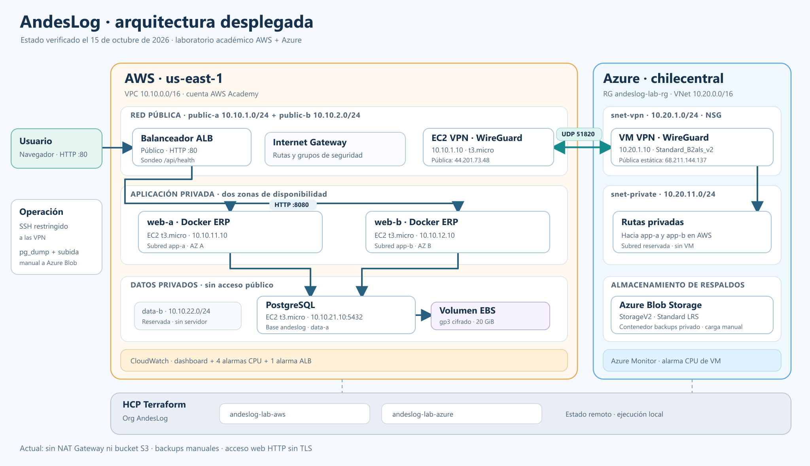

# AndesLog — infraestructura desplegada

Estado comprobado el **15 de octubre de 2026** con el estado remoto de Terraform, AWS CLI, Azure CLI y la respuesta pública del ERP.



[Abrir el diagrama vectorial SVG](./arquitectura-actual.svg)

## Cómo funciona

1. El navegador entra por **HTTP puerto 80** al Application Load Balancer (ALB) público de AWS.
2. El ALB distribuye las peticiones entre **web-a** y **web-b**, dos EC2 privadas que ejecutan el ERP en Docker por el puerto **8080**. Comprueba `/api/health`; ambos destinos estaban saludables al revisar el despliegue.
3. Las dos instancias ERP usan **PostgreSQL** en una tercera EC2 privada por el puerto **5432**. La base `andeslog` almacena sus datos en un volumen **EBS gp3 cifrado de 20 GiB**.
4. Una EC2 de AWS y una VM de Azure forman un túnel **WireGuard por UDP 51820**. Las rutas conectan las subredes de aplicación de AWS con la red privada de Azure.
5. Azure ofrece un contenedor **Blob privado** para respaldos. El `pg_dump` y la subida son **manuales**; el despliegue no programa copias ni replica PostgreSQL.

## Inventario actual

| Plataforma | Recursos principales | Red / función |
| --- | --- | --- |
| AWS `us-east-1` | VPC, Internet Gateway, seis subredes, rutas y grupos de seguridad | VPC `10.10.0.0/16`; públicas `10.10.1.0/24` y `10.10.2.0/24`; privadas de aplicación `10.10.11.0/24` y `10.10.12.0/24`; privadas de datos `10.10.21.0/24` y `10.10.22.0/24`. La última está reservada. |
| AWS | ALB público, grupo de destino y dos EC2 web `t3.micro` | ALB `:80` → ERP Docker `:8080`; web-a `10.10.11.10`, web-b `10.10.12.10`. |
| AWS | EC2 PostgreSQL `t3.micro` + EBS | DB `10.10.21.10:5432`; volumen de datos cifrado de 20 GiB. PostgreSQL se administra en EC2, no en RDS. |
| AWS | EC2 WireGuard `t3.micro` | VPN `10.10.1.10`; IP pública observada `44.201.73.48`; también sirve de salto SSH hacia las EC2 privadas. |
| AWS | CloudWatch | Dashboard `andeslog-lab-overview`, cuatro alarmas de CPU EC2 y una de destinos ALB no saludables. |
| Azure `chilecentral` | Resource Group, VNet, NSG, rutas, NIC y VM WireGuard `Standard_B2als_v2` | Grupo `andeslog-lab-rg`; VNet `10.20.0.0/16`; VM `10.20.1.10`, IP pública estática `68.211.144.137`. La subred privada `10.20.11.0/24` está reservada, sin VM. |
| Azure | StorageV2 Standard LRS y Azure Monitor | Cuenta `andeslog13fdbba367907`, contenedor Blob privado `backups`, alerta de CPU de la VM VPN. |
| HCP Terraform | Dos workspaces en la organización `AndesLog` | `andeslog-lab-aws` y `andeslog-lab-azure`; estado remoto y ejecución local con las sesiones académicas de cada proveedor. |

## Acceso y operación

- ERP: [http://andeslog-lab-alb-2124124191.us-east-1.elb.amazonaws.com](http://andeslog-lab-alb-2124124191.us-east-1.elb.amazonaws.com). El usuario inicial es `admin`. Su contraseña está en `environments/lab/aws/andeslog.runtime.secret`, variable `BOOTSTRAP_ADMIN_PASSWORD`; ese archivo es local y no debe subirse a Git.
- Salud pública: [http://andeslog-lab-alb-2124124191.us-east-1.elb.amazonaws.com/api/health](http://andeslog-lab-alb-2124124191.us-east-1.elb.amazonaws.com/api/health). El sondeo del ALB verifica la respuesta web; el acceso a la base también quedó comprobado al migrar el esquema e iniciar sesión.
- Imagen del ERP: `ghcr.io/pnk-dev/andeslog-erp:v1.0.0`. El paquete GHCR es privado; en este despliegue la imagen se cargó desde un archivo Docker local en ambas EC2. Si una instancia web se reemplaza, habrá que cargarla de nuevo o publicar una imagen accesible para el arranque.
- Respaldos: el contenedor Azure Blob es un **destino**, no una copia automática. El procedimiento `pg_dump` y subida está en el [README principal](../README.md#respaldos-hacia-azure-blob-y-s3-opcional).
- Comprobación desde PowerShell, con la sesión académica y el login HCP vigentes:

  ```powershell
  $env:TF_CLOUD_ORGANIZATION = "AndesLog"
  Push-Location .\environments\lab\aws
  terraform output
  Pop-Location
  Push-Location .\environments\lab\azure
  terraform output
  Pop-Location
  Invoke-RestMethod "http://andeslog-lab-alb-2124124191.us-east-1.elb.amazonaws.com/api/health"
  ```

## Límites importantes del laboratorio

- **HTTP no cifra el acceso web**. Este entorno usa HTTP por la decisión de laboratorio; antes de manejar datos reales se necesita dominio y TLS.
- **No hay NAT Gateway ni bucket S3 activos**. La NAT temporal se eliminó tras instalar los paquetes; S3 está desactivado por restricciones de AWS Academy.
- **La IP pública de la VPN AWS no es Elastic IP** (`create_vpn_eip = false`). Si cambia al reemplazar la EC2, hay que actualizar el peer y la regla `/32` de Azure antes de recuperar el túnel.
- La base, la VPN de cada nube y el almacenamiento local de PostgreSQL son puntos únicos de falla. Las alarmas actuales no envían correo: no hay SNS ni Action Group configurados.
- EC2, ALB, EBS, VM/IP pública de Azure y Storage consumen créditos mientras estén desplegados. Las etiquetas TTL no los apagan ni eliminan automáticamente. La [sección de destrucción del README](../README.md#revisión-y-destrucción-total-del-laboratorio) explica cómo retirarlos.
