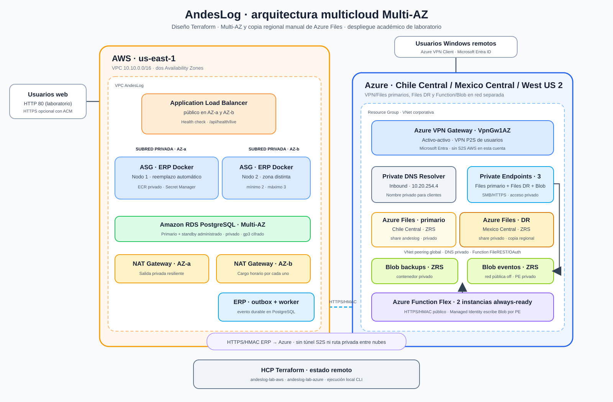

# Arquitectura multicloud definida en Terraform

Este documento describe los recursos declarados por los roots de Terraform del laboratorio. No confirma que estén desplegados en este momento. El estado real depende de los workspaces HCP Terraform `andeslog-lab-aws` y `andeslog-lab-azure`, las credenciales y las opciones usadas durante la ejecución.

## AWS — `environments/lab/aws`

- **Red:** VPC `10.10.0.0/16`, Internet Gateway, rutas y seis subredes: dos públicas (`10.10.1.0/24`, `10.10.2.0/24`), dos privadas de aplicación (`10.10.11.0/24`, `10.10.12.0/24`) y dos de datos (`10.10.21.0/24`, `10.10.22.0/24`). La segunda subred de datos queda reservada.
- **Entrada web:** Application Load Balancer público en las dos subredes públicas. HTTP puerto 80 está siempre configurado. HTTPS puerto 443 y redirección HTTP→HTTPS se crean si se proporciona un ARN de certificado ACM.
- **ERP:** dos EC2 Ubuntu privadas ejecutan la imagen Docker indicada en `erp_image`, escuchando en 8080. El script `scripts/lab.ps1` construye/carga la imagen y configura ambas instancias. El ALB distribuye tráfico y consulta `/api/health`.
- **Base de datos:** EC2 Ubuntu privada con PostgreSQL en 5432. Los datos viven en un volumen EBS gp3 separado, cifrado, de 20 GiB. Los volúmenes raíz de las EC2 también se configuran cifrados.
- **Túnel:** EC2 Ubuntu WireGuard en la subred pública, UDP 51820, con encaminamiento habilitado. Sirve además como salto SSH a las instancias privadas. La Elastic IP de esta EC2 está desactivada por defecto.
- **Controles de red:** Security Groups separan ALB, web, base de datos y VPN. La base acepta PostgreSQL desde web; SSH a hosts privados pasa por el peer VPN; SSH administrativo a la VPN solo se crea cuando se proporciona un CIDR administrativo `/32`.
- **Observabilidad:** dashboard CloudWatch, cuatro alarmas CPU de EC2 y una alarma de destinos no saludables del ALB. No se crea SNS ni se envían notificaciones.
- **Opciones:** NAT Gateway temporal de bootstrap, S3 de backups y versionado, Elastic IP, ruta de PostgreSQL hacia Azure y HTTPS ACM. `lab.ps1 -Action Deploy` usa NAT temporal durante el aprovisionamiento y luego lo retira.

## Azure — `environments/lab/azure`

- **Contenedor de red:** Resource Group, VNet `10.20.0.0/16`, subred VPN `10.20.1.0/24`, subred privada `10.20.11.0/24`, NSG y tabla de rutas. Las rutas de la subred privada envían las redes de aplicación AWS al peer WireGuard.
- **Túnel:** VM Ubuntu con IP privada `10.20.1.10`, IP pública estática, NIC con IP forwarding y WireGuard UDP 51820. La VM usa autenticación SSH por clave pública. Es una VPN de software autogestionada; no se crea Azure VPN Gateway.
- **Reglas:** el NSG permite WireGuard desde la IP pública AWS configurada, SSH administrativo solo si se especifica CIDR `/32`, y tráfico necesario del peer hacia las redes web AWS. Deniega el resto del tráfico entrante. La extensión OpenVPN para usuarios agrega UDP 1194 si se activa.
- **Backups Blob:** StorageV2 Standard LRS y contenedor privado `backups`. Se exige HTTPS/TLS 1.2, acceso anónimo desactivado, acceso de datos por Microsoft Entra ID y sin claves compartidas. Este servicio es un destino; por sí solo no ejecuta `pg_dump` ni programa respaldos.
- **Alerta:** Azure Monitor alerta cuando el promedio de CPU de la VM supera 70% durante cinco minutos. No se crea Action Group.
- **Azure Files opcional:** Storage Account distinto al de Blob, share SMB `andeslog`, Private Endpoint, DNS privado y acceso público deshabilitado. El tamaño de cuota por defecto es 10 GiB. Se crea con `enable_remote_access`/`-EnableRemoteAccess`; el script configura OpenVPN en la VM existente.
- **Azure Functions opcional:** Flex Consumption con runtime Python 3.12 para auditar objetos de backup. Incluye identidad administrada, asignación RBAC Blob, almacenamiento de host y contenedor privado de publicación, contenedor de resultados `backup-audit`, y suscripción Event Grid a objetos nuevos bajo `backups/`. Se activa con `-EnableBackupAudit`; el script publica el código y luego crea la suscripción.

## Componentes habilitados por defecto

Los valores de `terraform.tfvars.example` dejan desactivados Azure Files/OpenVPN, Azure Functions, la asignación RBAC opcional para el usuario que despliega, AWS S3, S3 versioning, Elastic IP AWS y HTTPS ACM. El almacenamiento Azure Blob y su contenedor privado forman parte de la base. Durante la acción `Deploy`, el script habilita NAT temporal para el bootstrap y lo apaga al final.

Las opciones adicionales pueden persistir en overlays locales ignorados por Git. Por eso, las opciones del ejemplo no bastan para inferir qué existe en el estado HCP actual; consulta ambos workspaces o usa `scripts/lab.ps1 -Action Status` con sesiones vigentes.

## Tráfico entre nubes

El túnel WireGuard conecta AWS `10.10.0.0/16` con Azure `10.20.0.0/16`. El flujo funcional esperado es:

1. Usuario → ALB AWS (`80`, o `443` si se configuró ACM) → EC2 web (`8080`).
2. EC2 web → PostgreSQL EC2 (`5432`).
3. VM Azure WireGuard ↔ VM AWS WireGuard (UDP `51820`) para la conectividad privada entre redes.
4. La ruta Azure permite alcanzar las subredes web AWS. La ruta de la subred PostgreSQL hacia Azure está desactivada por defecto.
5. Si Azure Files está habilitado, los clientes usan OpenVPN hacia Azure y SMB al endpoint privado de Files. Blob de backups es un servicio diferente y no es una carpeta SMB.

## Estado y límites

- AWS y Azure se administran desde roots y workspaces HCP independientes; `scripts/lab.ps1` coordina el orden y las dependencias entre ambos.
- La EC2 de PostgreSQL, las dos VPN y la base de datos son componentes autogestionados; no hay RDS, alta disponibilidad administrada ni Azure VPN Gateway.
- La aplicación pública usa HTTP si no se proporciona certificado ACM.
- Los flags opcionales, los permisos de las cuentas académicas y el estado actual pueden cambiar el inventario real frente a este diseño.
